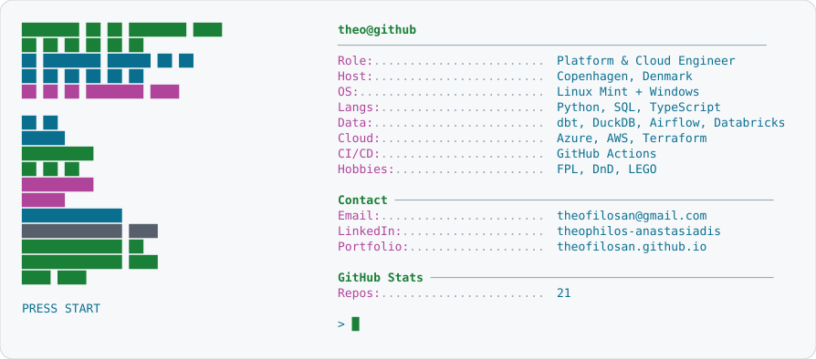

<a href="https://theofilosan.github.io">
  <picture>
    <source media="(prefers-color-scheme: dark)" srcset="dark_mode.svg">
    
  </picture>
</a>

<a href="https://theofilosan.github.io"><picture><source media="(prefers-color-scheme: dark)" srcset="link_portfolio_dark.svg"></picture></a><a href="https://www.linkedin.com/in/theophilos-anastasiadis"><picture><source media="(prefers-color-scheme: dark)" srcset="link_linkedin_dark.svg"></picture></a><a href="mailto:theofilosan@gmail.com"><picture><source media="(prefers-color-scheme: dark)" srcset="link_email_dark.svg"></picture></a>

## What I'm working on

- [football-analytics-dbt](https://github.com/Theofilosan/football-analytics-dbt): StatsBomb open data, DuckDB, dbt, Evidence dashboard
- [fpl-agent](https://github.com/Theofilosan/fpl-agent): Fantasy Premier League analysis CLI
- [theofilosan.github.io](https://theofilosan.github.io): my portfolio and CV

## Tools

Terraform, GitHub Actions, Azure, AWS, Databricks, Python, SQL, dbt, DuckDB, Airflow
